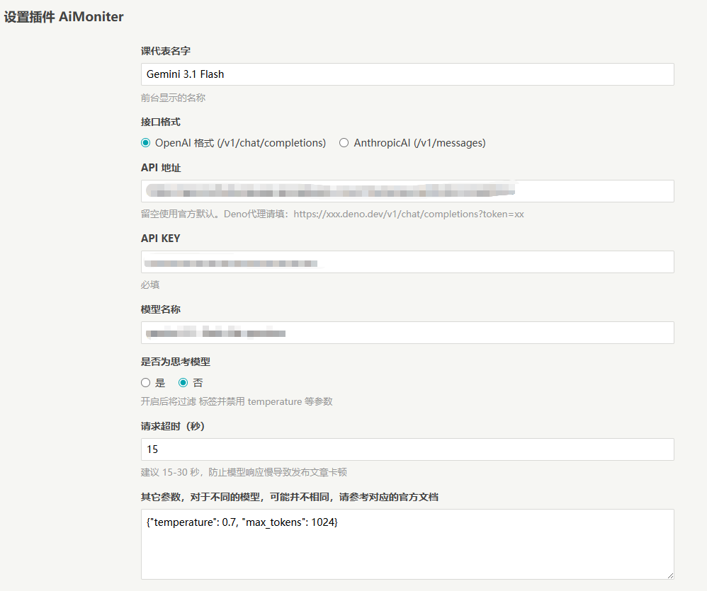

<div align="center">

# 🤖 AI课代表 (AiMoniter)

[](https://github.com/xa1st/Typecho-Plugin-AiMoniter/releases/latest)
[](https://license.coscl.org.cn/MulanPSL2)

[](https://typecho.org)

**让 AI 帮你评价博客文章的 Typecho 插件**  
**支持 Chat / Messages / Responses 三种接口格式（OpenAI、Anthropic Claude 等，可通过中转接入 Gemini）**

[简体中文](README.md) | [English](README_EN.md) 

</div>

<p align="center">
  
</p>

## ✨ 功能特性

- 🤖 **多协议支持** - Chat / Messages / Responses 三种接口格式
- 🎯 **智能评价** - AI 自动为每篇文章生成个性化评论
- ⚡ **自动触发** - 文章发布后自动生成 AI 评价
- 🛠️ **高度可配置** - 支持自定义 API 地址、模型参数（JSON透传）
- 🎨 **友好界面** - 简洁直观的后台配置界面
- 🧠 **思考模型支持** - 可过滤 `<think>` 等思考内容，保留最终回答
- 🌐 **中转示例** - 提供 Cloudflare/Deno 中转脚本示例（Gemini OpenAI 协议）

## 支持的AI服务

### Chat（OpenAI 兼容接口）
- 协议：`/v1/chat/completions`
- 可直连 OpenAI 官方，也可使用任意兼容该协议的服务或中转

### Messages（Anthropic Claude）
- 协议：`/v1/messages`
- 需要 `x-api-key` 与 `anthropic-version` 头

### Responses（OpenAI 新版接口）
- 协议：`/v1/responses`
- 面向 GPT-5.x、o 系列等新一代模型，旧写法 `max_tokens` 会自动映射为 `max_output_tokens`

## 安装

1. 下载插件解压到 Typecho 的插件目录：`usr/plugins`
2. 将文件夹`Typecho-Plugin-AiMoniter-版本号`改名为`AiMoniter`
3. 在 Typecho 后台激活插件
4. 配置 AI 服务的 API 密钥和相关参数

## 配置

### 基本配置

1. **AI 服务提供商**：选择要使用的接口格式（Chat / Messages / Responses）
2. **API KEY**：输入对应服务的 API 密钥
3. **模型名称**：指定要使用的具体模型
4. **API 地址**：必填，自定义 API 地址（支持中转/代理）。支持两种写法：只填根路径（如 `https://api.xxx.com/v1`，按接口格式自动补全接口路径），或完整地址（中转可带 token）

### 高级配置

- **温度参数**：控制输出随机性（具体范围以模型文档为准）
- **最大Token数**：限制 AI 输出长度（部分接口为必填）
- **超时时间**：请求超时设置
- **评价提示词**：自定义 AI 评价的提示词模板
- **思考模型**：开启后会过滤 `<think>...</think>` 等思考内容

## 使用

插件激活后，每当发布新文章时，AI 会自动生成评价并以JSON格式保存到数据库的 `ai_comment` 字段中。

你可以在主题中在post.php中加入以下代码，获取和显示 AI 评价：

```php
<!-- AI课代表 开始 -->
<?php $aiComment = json_decode((string)$this->fields->ai_comment, true); ?>
<?php if (isset($aiComment['say']) && !empty($aiComment['say'])): ?>
  <article class="post ai-comment">
    <div class="ai-moniter-container">
      <h2>AI课代表总结 - 当前课代表: <?php echo htmlspecialchars($aiComment['ainame'] ?? '无名氏'); ?></h2>
      <p><?php echo htmlspecialchars($aiComment['say']); ?></p>
    </div>
  </article>
<?php endif; ?>
<!-- AI课代表 结束 -->
```

### AI 评价数据结构

插件将AI评价以JSON格式存储，包含以下字段：

```json
{
  "ainame": "AI课代表",          // AI课代表的名称
  "say": "这是AI生成的评价内容"    // AI生成的评价文本
}
```

## 注意事项

1. 确保服务器可以访问对应的 AI 服务 API
2. 注意 API 使用限额和费用
3. 建议设置合理的超时时间和 Token 限制
4. 卸载插件时可选择保留或删除生成的数据

## 更新日志

> 完整更新历史请查看 [CHANGELOG.md](CHANGELOG.md)

### v2.3.0
- ✨ **新增 Responses 格式**：支持 OpenAI 新版 `/v1/responses` 接口（GPT-5.x、o 系列等新一代模型）
- 🔧 **接口选项更名**：`openai` / `anthropicai` 更名为 `chat` / `messages` / `responses`，旧配置自动兼容
- 🐞 **修复错误**：修复 AI 请求超时、接口异常或数据库主键冲突时中断文章发布的问题，相关失败不再抛出异常，只记录为前台「生成失败」提示

### v2.2.0
- 🔧 **代码优化**：精简现有的存储内容，取消多余判定
- 🐞 **修复错误**：修复部分错误

### v2.1.0
- ✨ **新增 Anthropic Claude 支持**
- 🔌 **OpenAI 兼容接口完善**：可接入第三方兼容服务
- 🌐 **中转示例**：提供 Cloudflare/Deno 的 Gemini 中转脚本

### v2.0.0
- 🚀 **重大更新**：插件更名为「AI课代表」
- ✨ **多AI支持**：新增 OpenAI 支持
- 🔧 **架构重构**：采用驱动模式，易于扩展
- 🎯 **配置优化**：更友好的配置界面
- 🛠️ **代码优化**：更好的错误处理和日志记录

### v1.0.0
- 初始版本，支持 Google Gemini

## 技术架构

```
AiMoniter/
├── Plugin.php          # 主插件文件
├── AiService.php       # AI 服务管理类
├── driver/             # AI 驱动目录
│   ├── BaseAI.php          # 基础驱动抽象类
│   ├── Chat.php            # Chat 驱动 (OpenAI 兼容)
│   ├── Messages.php        # Messages 驱动 (Anthropic Claude)
│   └── Responses.php       # Responses 驱动 (OpenAI 新版接口)
├── scripts/            # 中转平台示例
│   ├── cloudflare.worker.js # Cloudflare Workers 版本
│   └── deno.dev.js          # Deno Deploy 版本
├── CHANGELOG.md        # 更新日志
└── README.md           # 说明文档
```

## 开发

### 添加新的 AI 服务

1. 在 `driver/` 目录下创建新的驱动类
2. 继承 `BaseAI` 抽象类
3. 实现 `generateContent()` 方法
4. 在 `AiService.php` 中注册新驱动

### 自定义提示词

支持以下占位符：
- `{title}`：文章标题
- `{text}`：文章内容（已清理HTML）
- `{url}`：文章链接

## 中转平台示例（scripts/）

为了方便使用 Gemini 的 OpenAI 兼容接口，`scripts/` 目录提供了两个可直接部署的中转示例：

- `scripts/cloudflare.worker.js`：Cloudflare Workers 版本  
  需要在环境变量中设置 `TOKEN`（必选）与 `GEMINI_URL`（默认 `https://generativelanguage.googleapis.com/v1beta/openai/chat/completions`）。

- `scripts/deno.dev.js`：Deno Deploy 版本
  同样支持 `TOKEN`（必选） 与 `GEMINI_URL` 环境变量。

两者都支持：
- `?token=YOUR_TOKEN` 方式进行简单鉴权
- CORS 处理
- 访问根路径返回健康检查信息

插件中使用时，将 **API 地址** 设置为中转地址，例如：  
`https://<你的域名>/v1/chat/completions?token=YOUR_TOKEN`  
也可以只填根路径 `https://<你的域名>/v1`，插件会按接口格式自动补全接口路径。

## 许可证

[MulanPSL2 License](https://github.com/xa1st/Typecho-Plugin-AiMoniter/blob/main/LICENSE)

## 作者

猫东东 <xa1st@outlook.com>

## 鸣谢

- [Typecho](https://typecho.org/)
- [冰剑](https://digu.com)

## 链接

- [GitHub 仓库](https://github.com/xa1st/Typecho-Plugin-AiMoniter)
- [问题反馈](https://github.com/xa1st/Typecho-Plugin-AiMoniter/issues)

